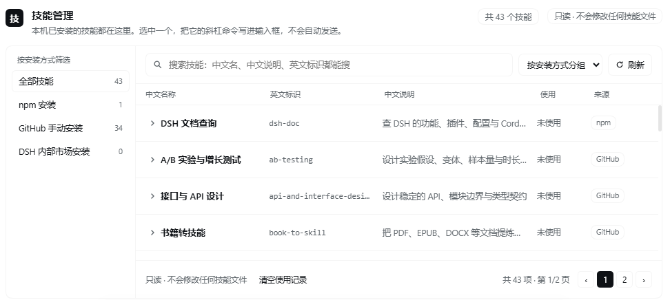

# dsh-skills-cn

[](https://www.npmjs.com/package/dsh-skills-cn)
[](https://www.npmjs.com/package/dsh-skills-cn)
[](./LICENSE)
[](https://github.com/deepseek-ai/deepseek-harness)

Read skills in Chinese, invoke them by their English id. A **Skills** view for DeepSeek Harness that lists every installed skill as *Chinese name + English id + Chinese description*, and writes the chosen `/skill-name` command into the composer — without sending it.



## Why

Once you collect a few skill packs, both `name` and `description` are English, and two things break:

- **Recall** — dozens of skills, irregular English ids; you cannot type the one you want.
- **Comprehension** — the English description does not tell you whether the skill fits your task.

This plugin puts Chinese and English side by side: Chinese name on the left, the untouched English `name` beside it, one command away. It never modifies a skill file and does not install anything.

## Features

- **Bilingual rows**: Chinese name (bold), English `name` (monospace, grey), one-line Chinese description, usage count and source tag.
- **Source groups**: a left column with All skills / npm install / GitHub (manual) / DSH market and their counts; a click filters the list. Skills whose source cannot be derived stay under All skills and are tagged *Other*.
- **Three sort orders**: most used (default, ties by most recent), name A→Z, grouped by source.
- **Paging**: 25 rows per page with numbered page buttons, total and page indicator; changing the search, group or sort returns to page 1 while the selection survives.
- **Usage counters**: each successful insert records a count and a last-used time, shown per row and clearable from the footer behind a confirmation.
- **Chinese overrides**: edit the Chinese name and description of any row; the manual entry always wins over the bundled dictionary and can be restored.
- **Expandable rows**: English source description, `whenToUse` and the skill path.
- **Instant search** across Chinese name, Chinese description, English id and the original English description.
- **One-click insert**: double-click, `Enter`, or the row's **Insert** button appends `/skill-name ` to the composer; the caret stays at the end and **nothing is sent**. The same command is not written twice.
- **Remembered view state**: group, sort and page survive a reload; the selected skill does not, so nothing is inserted by accident.
- **Read-only**: no skill directory or `SKILL.md` is created, changed or removed; the English `name` is never rewritten.
- **Offline**: Chinese text comes from the bundled dictionary plus your own edits — no network, no model call.
- **Theme and locale aware**, with a stacked layout on narrow views.

## How it differs from similar plugins

| | This plugin | Floating-ball browsers | Composer-button pickers |
|---|---|---|---|
| Chinese name + description | ✅ bundled dictionary | partial / none | none (English only) |
| Entry point | a view tab in the conversation header | floating ball + multi-tab panel | a button beside the composer |
| Insert semantics | `inputActions`, insert without sending | implementation-specific | insert without sending |
| Network / model quota | none | implementation-specific | implementation-specific |
| Footprint | one `client.js`, no build, no dependencies | heavier | medium |

Each plugin makes a different trade-off; this one does a single thing — **let a Chinese reader understand a skill and invoke it**.

## Install

Requires **DeepSeek Harness 0.2.x** (verified on `0.2.2-rc.3`, both Desktop and Web).

### npm (recommended)

```bash
dsh plugin --profile desktop add dsh-skills-cn
```

Replace `desktop` with your profile name (`web` for the web profile). Restart DSH, then check the enablement step below.

### From GitHub

```bash
dsh plugin --profile desktop add github:YOUR_GITHUB/dsh-skills-cn
```

### From a local checkout

Settings → **Plugins** → **Add plugin** → pick the cloned directory, or:

```bash
dsh plugin --profile desktop add /path/to/dsh-skills-cn
```

### Enable and verify

Open **Settings → Plugins** and make sure the “Skill manager (Chinese)” row is enabled. Back in a conversation, the header tab row should show **Skills** between *Workflow* and *Stats*. If it is missing, reload the page (`Ctrl+R`).

## Usage

1. Open any conversation and click the **Skills** tab.
2. Filter with the left column, or search in Chinese (“视频”, “表格”) or English (`sheet`, `test`).
3. Switch the sort order in the toolbar; page through the list at the bottom when there are more than 25 rows.
4. `↑` / `↓` to move, `Enter` to insert — or double-click a row, or click **Insert**.
5. The composer now holds `/api-and-interface-design`; write your request after it and press Enter yourself.
6. To edit the Chinese text, use ✎ on the row (or the button in the expanded area). Clear usage records from the footer.
7. `Esc` clears the search; `▸` expands the English source and the skill path.

## Where the Chinese comes from

`client.js` ships a **TERMS** dictionary (46 entries today) keyed by the skill's English `name`, each mapping to `[Chinese name, Chinese description]`. Skills that are not in the dictionary do not disappear: they render their English name and description with a small “no Chinese entry” marker — use ✎ to add one, and that manual entry wins from then on.

Adding an entry to the dictionary itself is one line — edit `TERMS` in `client.js` and open a PR:

```js
'markdown-export': ['Markdown 导出', '把会话导出成 Markdown 文件'],
```

## Where the data lives

Only three `localStorage` keys, never the skill directories:

| Key | Contents |
|---|---|
| `dsh-skills-cn/cache/v1` | Your manual Chinese name/description overrides |
| `dsh-skills-cn/usage/v1` | Usage counts and last-used times |
| `dsh-skills-cn/ui/v1` | Last group, sort order and page |

Clearing them resets the plugin; no skill file is touched.

## Compatibility

| | |
|---|---|
| DSH | `>=0.2.0-rc.1 <0.3.0` (verified `0.2.2-rc.3`) |
| Platforms | Web and Desktop (the Electron shell loads the same web UI) |
| Theme | follows light and dark (all colours are `--dsw-alias-*` tokens) |
| Locale | UI in Chinese and English; skill ids stay English |

The only DSH internal it depends on is **`skills/list`** — the same catalog the `/` slash menu uses — probed as `skills` → `sessionSkillCatalog` → `skillCatalog`. Insertion uses the composer's `inputActions`, degrading from `insertText` to `setDraft` to the clipboard. If any layer is unavailable the panel still mounts and shows a “catalog unavailable / retry” state instead of a blank slot.

## Privacy and read-only guarantees

- Reads the skill catalog DSH already loaded; it does not walk the disk or parse `SKILL.md`.
- Uploads nothing and makes no network requests.
- Writes no skill file, and stores no data of its own.

## Reinstalling on a new machine

The plugin has no configuration to back up; two commands bring it back:

```bash
dsh plugin --profile desktop add dsh-skills-cn
# or, from source
dsh plugin --profile desktop add github:YOUR_GITHUB/dsh-skills-cn
```

Restart DSH, confirm the row is enabled in **Settings → Plugins**, reload the page.

## Development

```bash
npm test            # node scripts/validate.mjs — manifest, files, locales, detail image, icon
npm run pack:check  # preview the published file list
```

Layout:

```
package.json          # dsh.bundle + dsh.client manifest
index.js              # host half (no host logic here)
client.js             # client half: tab, list, search, insert (__ModuleLoader__ format, no build)
cordis.patch.yml      # inserts the bundle row with id skill-manager
locale/{en,zh}.json   # plugin page title/description/detail
icon.svg              # plugin icon
docs/                 # detail image and README screenshots
scripts/validate.mjs  # pre-publish self check
```

Local iteration:

```bash
dsh plugin --profile desktop add /absolute/path/dsh-skills-cn
```

Client-side edits apply on page reload; `package.json` or `cordis.patch.yml` changes need a reinstall and restart.

## FAQ

**The tab is missing.** View tabs belong to a session — open one first, confirm the plugin is enabled, then reload.

**The list is empty.** This DSH build does not expose a skill catalog; the panel shows a retry button instead. Check the supported DSH range.

**Insert does nothing.** It falls back from the composer API to the draft API to the clipboard; if all fail it reports the failure and keeps the panel state rather than pretending.

**It shows 43 skills but I installed 29.** The number is the *session-visible* catalog, which includes skills contributed by the agent preset, not just `~/.agents/skills`.

## License

[MIT](./LICENSE)
