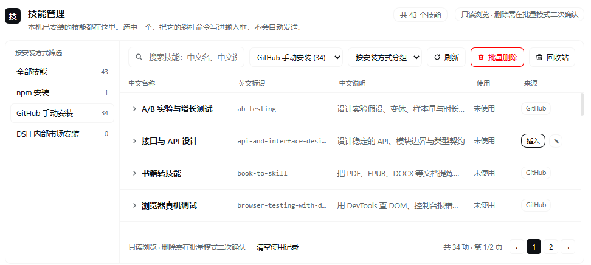
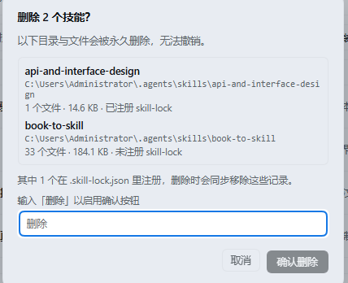
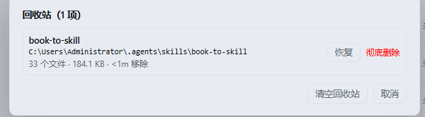

# dsh-skills-cn

**中文** | [English](README.en.md)

[](https://github.com/GoForIt-2026/dsh-skills-cn/actions/workflows/ci.yml)
[](https://github.com/GoForIt-2026/dsh-skills-cn/releases)
[](./LICENSE)
[](https://nodejs.org)
[](https://github.com/deepseek-ai/deepseek-harness)

看中文，叫得出英文。给 DeepSeek Harness 加一个「技能管理」页签：把本机已装的技能按 **中文名 + 英文标识 + 中文说明** 列出来，选中一个就把 `/skill-name` 写进输入框——只写不发送。



## 它解决什么问题

技能包装多了以后，`name` 和 `description` 全是英文，常见两个卡点：

- **记不住**：几十个技能，英文标识没规律，想调用时拼不出名字；
- **看不懂**：英文描述读完也判断不出这个技能能不能干自己的活。

这个插件把「看懂」和「叫得出」放在同一个面板里：左边中文，右边英文原名，选中即写命令。它**不修改任何技能文件**，也不负责下载安装。

## 功能

- **中英对照**：每行是中文名（粗体）、英文 `name`（等宽灰字）、一行中文说明、使用次数与来源标签。
- **按来源分组**：左栏「全部技能 / 用户目录 / DSH 内置 / 插件提供 / 其他」带数量，点一下即筛选。分组的依据是 DSH 技能注册表里的 `source` 字段（不是从路径猜的），五组数量之和等于「全部技能」。
- **提供方与目录两列**：每行显示注册它的 provider（如 `agent-skills`、`office`）和技能实际所在的目录；运行时注册、没有文件路径的技能会标「无目录（运行时注册）」。
- **列宽可拖动**：每个列的右边缘都能拖，宽度记在本地；最后一个表头的 `⟲` 一键恢复默认。列变宽后表格横向滚动，不会被截断。
- **三种排序**：「常用优先」（默认，次数相同按最近使用时间）、「名称字母序」、「按来源排序」。
- **分页**：每页 25 条，底部为页码条 + 总数 + 当前页；换页、换分组、改搜索都会回到第 1 页，**已选中的技能跨页保留**。
- **使用频次**：手动「插入」记一次，**模型自动调用技能也记一次**；行内显示总数（「已用 N 次 / 未使用」），悬停拆成「手动 M / 自动 A」；底部「清空使用记录」带二次确认，会把两边一起清。自动计数不消耗任何 token（详见下面「使用次数怎么算」）。
- **编辑中文**：任意一行都能改中文名与中文说明，保存后优先于内置词典；也能一键「恢复自动」。
- **展开原文**：展开行可见英文原描述、适用场景与技能路径，便于核对。
- **即时搜索**：中文名、中文说明、英文标识、英文原描述都能命中。
- **一键写入**：双击、`Enter`、或点行内的「插入」，把 `/skill-name ` 追加到输入框，光标停在末尾，**不会自动发送**；同一条命令不会重复写入。
- **记住状态**：分组、排序、页码在刷新后保留；选中的技能不跨会话保留，避免误引入。
- **只读浏览**：正常模式下不创建、不修改、不删除任何技能文件；删除只发生在下面说的批量模式里。
- **批量删除**：工具栏「批量删除」进入选择模式，勾选后二次确认，真实删除技能目录，并同步清理 `~/.agents/.skill-lock.json` 里注册过的记录（详见下一节）。
- **离线**：中文对照来自内置词典与你的手动补充，不联网、不调用模型、不消耗额度。
- **跟随主题与语言**：颜色走 DSH 主题 token，文案走 locale（中/英）；窄屏自动切成堆叠布局。

## 删除技能（默认进回收站）



行内**没有**删除按钮。删除只能这样走：

1. 点工具栏 **批量删除**（红色描边）进入选择模式——此时每行出现复选框，双击、`Enter`、`↑` `↓`、行内「插入」「✎」全部停用，避免误操作。
2. 勾选要删除的技能。**只有用户手装目录里的技能可以勾选**：`~/.agents/skills`、`~/.dsh/skills`、`~/.dsh/agent-skills`。由 npm、DSH 市场或预设提供的技能会置灰并提示「请用对应包管理器卸载」——在面板里删 `node_modules` 里的目录会把包弄坏，所以不做。
3. 点「删除选中…」，确认框会逐条列出**中文名、英文标识、完整目录路径、文件数/大小、是否在 skill-lock 注册**。
4. 必须手动输入 **删除** 两个字，「确认删除」才会可点。确认框开着时键盘完全归它：在输入框里打字、按 `Enter` 都不会写进对话输入框，`Esc` 关闭弹窗。

### 回收站（默认，可恢复）



确认框里 **「先移到回收站（可恢复）」默认勾选**。技能目录会被移动到 `<技能根目录>/../.skill-trash/<id>/`（`~/.agents/skills` → `~/.agents/.skill-trash/`），同时把它的锁记录一起存进该条目的 `meta.json`。

工具栏右侧的 **回收站 (N)** 打开回收站面板：

- 每条显示技能名、原路径、文件数/大小、移除时间；
- **恢复**：目录移回原位置，并把之前剪掉的 `.skill-lock.json` 记录**写回去**（目标已存在则拒绝，不会覆盖）。写锁失败时，文件会被**退回回收站**、条目保留，并在提示里给出原因，可以直接重试——不会出现「文件回来了、注册信息没回来」的中间状态；
- **彻底删除 / 清空回收站**：真正抹掉，带二次确认。

从没注册过的技能，删除和恢复都**不碰**锁文件（单测里对锁文件的内容和时间戳都做了断言）。

取消勾选「先移到回收站」就是**永久删除**（会显示红色警告），和 1.2.0 的行为一致。

### 锁文件怎么处理

- 删除（无论进回收站还是永久删）都会把注册过的名字从 `~/.agents/.skill-lock.json` 里移除；写盘是「临时文件 + 重命名」的原子替换，`version`、`dismissed` 以及你不认识的字段原样保留。
- **只有和锁同根的那份技能才算它的注册记录**：锁文件管的是 `~/.agents/skills`。如果同名技能装在 `~/.dsh/skills` 或 `~/.dsh/agent-skills`，删它不会动 `~/.agents` 那份的注册信息，回收站条目也不会带上别人的记录（恢复时同样校验归属，包括 1.4.0–1.4.2 留下的旧条目）。
- 从没注册过的手动技能，锁文件**一个字节都不会改**。
- 恢复时若原技能在锁里注册过，会把记录写回；锁里已有同名记录则不重复写。
- 锁文件本身解析失败时（包括 `skills` 字段不是对象），**整个删除请求中止**，一个文件都不删——避免「文件删了、锁没更新」的报错状态。
- 目录**已经不存在**但锁里还有记录时，只清理这条记录，不会报成删除失败。
- 目标目录是符号链接、名称含路径分隔符等情况会逐项跳过并说明原因。

删除依赖插件的 **Host 半边**（浏览器端拿不到文件系统权限）。Host 半边没加载时，按钮会提示「删除服务不可用：需要 Host 半边并重启 DSH」，其它功能照常。

## 和同类插件的区别

| | 本插件 | 悬浮球类（如 dsh-skill-browser） | 输入框按钮类（如 dsh-skill-picker） |
|---|---|---|---|
| 中文名 + 中文说明 | ✅ 内置词典 | 部分/无 | 无（只显示英文） |
| 入口位置 | 对话区顶部页签（和其它视图并列） | 悬浮球 + 多 Tab 面板 | 输入框旁按钮 |
| 写入方式 | `inputActions`，只写不发 | 视实现 | 只写不发 |
| 联网 / 模型额度 | 完全不使用 | 视实现 | 视实现 |
| 代码体量 | 单文件 `client.js`，无构建、无依赖 | 较重 | 中等 |

同类插件各有取舍，本插件只做一件事：**让中文用户看懂并叫得出一个技能**。

## 安装

需要 **DeepSeek Harness 0.2.x**（实测 `0.2.2-rc.3`，Desktop 与 Web 均可），Node ≥ 20。

### 方式一：从 GitHub 直接装（推荐，复制一行就行）

```bash
dsh plugin --profile desktop add github:GoForIt-2026/dsh-skills-cn
```

DSH 会把这条 spec 交给 pnpm，从仓库按 `package.json` 的 `files` 打出包再装进 profile——不用 clone、不用编译、没有依赖。

也可以下载 [最新 Release 的 `.tgz`](https://github.com/GoForIt-2026/dsh-skills-cn/releases/latest) 本地装：

```bash
dsh plugin --profile desktop add ./dsh-skills-cn-1.4.4.tgz
```

### 方式二：npm（发布到 npm 后可用）

```bash
dsh plugin --profile desktop add dsh-skills-cn
```

### 方式三：本地目录

插件管理页 → **添加插件** → 选择克隆下来的目录；或：

```bash
dsh plugin --profile desktop add /path/to/dsh-skills-cn
```

把 `desktop` 换成你自己的 profile 名（Web 版一般是 `web`）。装完重启 DSH，再按下面的「启用」确认。

### 启用与验证

打开 **设置 → 插件**，确认「技能管理」这一行是启用状态；回到对话页，顶部视图条应出现 **技能管理** 页签，位置在「工作流」与「统计」之间。没出现时先刷新页面（`Ctrl+R`）。

## 使用

1. 打开任一会话，点顶部 **技能管理**。
2. 左栏按来源筛选，或直接在搜索框输入中文（「视频」「表格」）与英文（`sheet`、`test`）。
3. 右上角切换排序；超过 25 条时用底部页码翻页。
4. `↑` / `↓` 移动，`Enter` 插入；也可以双击某行，或点行内「插入」。
5. 输入框里出现 `/api-and-interface-design`，后面接着写你的需求，自己按回车发送。
6. 想改中文：点行内 ✎ 或展开后的「编辑中文对照」，保存即生效；「清空使用记录」在底部。
7. `Esc` 清空搜索（有弹窗时先关弹窗）；`▸` 展开英文原文与技能路径。

## 技能条目从哪里来

插件**不扫任何目录**：它调用当前会话的 `skills/list`（就是 `/` 菜单用的同一份技能目录），拿到的每条包含 `name` / `description` / `whenToUse` / `path`。这份目录由 DSH 汇总，本机上 43 条的来源是：

| 来源 | 条数 | 磁盘位置 |
|---|---|---|
| 你手动从 GitHub 装的技能 | 34 | `~/.agents/skills/<name>/SKILL.md` |
| DSH 预设技能 | 1 | 应用包内 `…/app.asar/dsh/node_modules/@deepseek-ai/dsh-agent-preset/skills/` |
| 内置/插件提供的技能（无文件路径） | 8 | office ×4、diagnose-windows-sandbox-acl、workflow-* ×3，由各自的插件在运行时注册 |

对应到左栏的四组是 **34 用户目录 + 6 DSH 内置 + 3 插件提供 + 0 其他**。

`~/.dsh/skills`、`~/.dsh/agent-skills`、`~/.claude/skills` 等目录在本机都是空的，所以没有条目来自那里。

### 来源标签怎么判定

分组依据是 Host 技能注册表返回的 `source`，不是从路径猜的：

| `source` | 分组 | 典型来源 |
|---|---|---|
| `user-agents` / `user-dsh` / 其它 `user-*` | 用户目录 | 你手动装进 `~/.agents/skills`、`~/.dsh/skills` 的技能 |
| `bundled` | DSH 内置 | 应用包与内置插件自带的技能（`office` ×4、`diagnose-windows-sandbox-acl` 等） |
| `custom` | DSH 内置 | DSH 配置里登记的技能目录（`customSkillDirs`）；本机指向应用包内的预设目录，也就是 `dsh-doc` |
| `runtime` | 插件提供 | 已安装插件在运行时注册的技能（`workflow-*` 等） |
| `project-dsh` / `project-agents` / 其它 | 其他 | 项目内技能目录与未能归类的条目（本机为空） |

行内「来源」标签和「提供方」列来自同一次注册表读取（`provider` 字段），只有拿不到注册表时才会退回按 `path` 的启发式判断（`.agents/skills` → 用户目录、`app.asar` → DSH 内置、`node_modules` → 插件提供）。这个标签只用于展示，**不参与删除许可**。

## 中文对照是怎么来的

`client.js` 里有一份 **TERMS** 词典（当前 46 条），键是技能的英文 `name`，值是 `[中文名, 中文说明]`。词典里没有的技能不会消失：它会照常显示英文名与英文描述，并在名字后标「未收录中文」——此时用行内 ✎ 补一条中文，覆盖值会保存下来并优先于词典。

想给词典本身补词条，改 `client.js` 的 `TERMS` 再提 PR 即可，一条一行：

```js
'markdown-export': ['Markdown 导出', '把会话导出成 Markdown 文件'],
```

## 数据存在哪里

浏览器本地存储（`localStorage`）里有三个键，与技能目录完全无关：

| 键 | 内容 |
|---|---|
| `dsh-skills-cn/cache/v1` | 你手动编辑的中文名与中文说明 |
| `dsh-skills-cn/usage/v1` | **手动**使用次数与最近使用时间 |
| `dsh-skills-cn/ui/v1` | 上次的分组、排序、页码 |

此外 Host 半边会写一个小文件，只存自动使用次数：

```
~/.dsh/skills-cn/usage.json      # {"version":1,"entries":{"<技能名>":{"auto":3,"lastAt":1731…}}}
```

它只有「技能名 / 次数 / 最近时间」，**不含任何技能内容**；写入是防抖（800ms）+「临时文件 + 重命名」原子替换，插件卸载时补一次 flush。删掉这个文件等于把自动计数清零，不影响技能文件。

清掉上面的 `localStorage` 键等于恢复面板的显示状态；技能文件不受任何影响。

## 使用次数怎么算（手动 / 自动）

| 来源 | 触发点 | 存在哪里 | 什么时候清零 |
|---|---|---|---|
| 手动 | 你点「插入」（写进输入框那一刻） | 浏览器 `localStorage` | 「清空使用记录」/ 重装系统 |
| 自动 | 模型通过 `skill` 工具加载该技能（含子代理） | `~/.dsh/skills-cn/usage.json` | 「清空使用记录」/ 删除该技能 / 删掉文件 |

自动计数是 Host 侧对 DSH 已有事件 `tools/result` 的**被动监听**：过滤器只看 `exec.name === 'skill'`，再从参数里取技能名 +1。它**不改提示词、不注册工具、不发起任何模型请求**，模型看到的上下文一字未变，所以**不产生任何额外 token**；真实开销只是内存里一个计数器和每次落盘几 KB 的 JSON。

两个口径不同：手动是「你把它写进了输入框」（哪怕最后没发送），自动是「模型真的加载了它」。所以列里显示总数，悬停看拆分——数字不会假装自己只有一个来源。

## 兼容性

| 项 | 状态 |
|---|---|
| DSH | `>=0.2.0-rc.1 <0.3.0`（实测 `0.2.2-rc.3`） |
| 平台 | Web / Desktop（Electron 窗口同样加载 Web 界面） |
| 主题 | 跟随明暗主题（全部用 `--dsw-alias-*` token） |
| 语言 | 界面中/英，技能名保英文 |

插件对 DSH 内部接口的依赖是 **`skills/list`**（就是 `/` 斜杠菜单用的同一个技能目录接口），并按 `skills` → `sessionSkillCatalog` → `skillCatalog` 依次探测；写入走输入框的 `inputActions`，按 `insertText` → `setDraft` → 复制到剪贴板三级降级。任一环节不可用时面板仍会挂载，并给出「读不到技能列表 + 重试」而不是白屏。

## 隐私与边界

- 浏览只读 DSH 自己已经加载的技能目录，**不扫盘、不解析 `SKILL.md`**。
- 不上传任何技能内容；除了本机 loopback 路由，不发起任何网络请求。
- 写操作只有两类：**你显式确认的批量删除**（删目录 + 同步 `.skill-lock.json`，需同源请求、专用请求头与手输确认词），以及 **`~/.dsh/skills-cn/usage.json` 的自动使用计数**（只有技能名/次数/时间）。
- 自动计数不会让模型多发一次请求、多读一段内容，**不消耗 token**。

## 重装系统 / 换机器怎么装回来

只要这个仓库还在，三条命令即可回到可用状态：

```bash
# 1. 装 DSH 后，先装插件（从 GitHub 一行搞定）
dsh plugin --profile desktop add github:GoForIt-2026/dsh-skills-cn

# 2. 重启 DSH
# 3. 设置 → 插件 里确认「技能管理」已启用，刷新页面
```

本插件的配置为零，不需要备份任何数据文件。

## 开发

```bash
npm test            # 自检 + 18 个 Host 单测（node --test）
npm run validate    # 只跑发布前自检：manifest/资源/语言包/详情图/图标
npm run test:host   # 只跑 Host 单测
npm run pack:check  # 预览将要发布的文件清单
```

目录结构：

```
package.json            # dsh.bundle + dsh.client 清单
index.js                # Host 半边：loopback 路由（/roots /catalog /preview /delete /trash-*）
host/skills-core.js     # Host 核心：目录定位、回收站、.skill-lock.json 原子读写（纯函数，可单测）
client.js               # Client 半边：页签、表格、搜索、写入、删除/回收站对话框（__ModuleLoader__ 格式，无构建）
cordis.patch.yml        # 插入 id 为 skill-manager 的 bundle 行
locale/{en,zh}.json     # 插件页标题/描述/详情
icon.svg                # 插件图标
docs/                   # 详情图与 README 截图
scripts/validate.mjs    # 发布前自检
scripts/test-host.mjs   # Host 单测（node:test）
```

本地联调（不发布也能装）：

```bash
dsh plugin --profile desktop add /绝对路径/dsh-skills-cn
```

client 侧改动刷新页面即生效；改 `package.json` 或 `cordis.patch.yml` 需要重装并重启。

## 常见问题

**页签没出现？** 视图页签属于会话，先打开一个会话；再确认「设置 → 插件」里已启用，然后刷新页面。

**列表是空的？** 说明当前 DSH 版本没有暴露技能目录接口，面板会显示重试按钮；请确认 DSH 版本在兼容范围内。

**点插入没反应？** 会依次尝试写入输入框、设置草稿、复制到剪贴板；如果都不可用会提示失败并保留面板状态，不会假装成功。

**显示 43 个技能，但我只装了 29 个？** 这里的数字是**当前会话可见的技能目录**（含预设自带的技能），不是 `~/.agents/skills` 的目录数。

## 参与

- 遇到问题 → [开 issue](https://github.com/GoForIt-2026/dsh-skills-cn/issues/new/choose)（有表单，会问版本和复现步骤）
- 想改代码 → [贡献指南](CONTRIBUTING.md)；没有构建步骤，`npm test` 就是全部检查
- 发现安全问题 → 走 [私密报告](SECURITY.md)，别开公开 issue
- 版本变化 → [CHANGELOG](CHANGELOG.md)；英文说明见 [README.en.md](README.en.md)

## License

[MIT](./LICENSE)
